<picture>
  <source media="(prefers-color-scheme: dark)" srcset="assets/banner-dark.svg">
  
</picture>

  
  
  

## About

I'm a Software Engineering graduate (B.Sc., Nanjing University of Aeronautics and Astronautics, 2024) based in Al Khobar, Saudi Arabia.

I build full-stack web applications with **Next.js, TypeScript and Supabase**, and I care about shipping things people actually use. One of my systems runs the day-to-day operations of a real business. Most of my products are **Arabic-first and fully bilingual**.

I speak **Arabic, English and Mandarin Chinese**. I studied for four years in China.

 

## Featured work

###  Thakirni · ذكرني

**An Arabic-first AI assistant that works on the web and directly in WhatsApp.**

Users chat in Arabic or English to schedule meetings and tasks in natural language. They can also save notes, record voice notes (transcribed automatically), search everything they've saved, and collaborate on team Kanban boards. Subscriptions run through Paddle.

`Next.js 15` `TypeScript` `Supabase` `PostgreSQL` `Groq LLaMA 3.3` `Whisper` `WhatsApp Business API` `Paddle` `Vercel`

[**Live site →**](https://thakirni.com) &nbsp;·&nbsp; [**Source code →**](https://github.com/EngSalman01/Thakirni)

---

### 🔧 Workshop management system

**A production system that runs daily operations at a car repair workshop in Saudi Arabia.**

It covers digital job cards, inspection reports with customer approval via WhatsApp links, printable technician work orders, payment and deposit tracking, and PDF generation. The interface is fully bilingual (Arabic/English) and covered by automated tests.

`Next.js` `TypeScript` `PostgreSQL` `Supabase` `Drizzle ORM` `next-intl` `Puppeteer` `Vitest` `Vercel`

🔒 The source code is private because it handles a client's business data. I'm happy to walk through the architecture in an interview.

---

### 🌉 Bridge defect detection · *Graduation thesis*

**A computer-vision system that automatically detects eight types of bridge defects from images.**

I trained and compared YOLOv8 and RetinaNet models. The best model reached **94% accuracy**.

`Python` `PyTorch` `YOLOv8` `RetinaNet` `Computer Vision`

 

## Tech stack

  
  
  
  
   
  
  
  
  
   
  
  
  
  
   
  
  
  

 

## Let's talk

I'm open to **software engineering and IT roles** across the Eastern Province and the wider GCC.
The best way to reach me is by [email](mailto:eng.salman01@outlook.com) or on [LinkedIn](https://www.linkedin.com/in/salmanrafid/).
