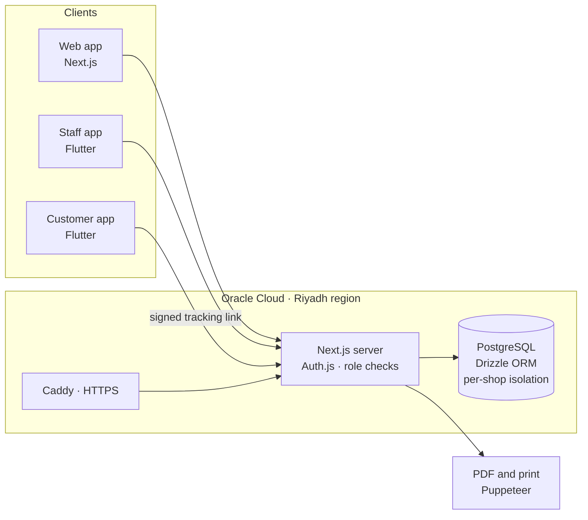

# 🚗 CarHub Pro · كارهب برو

**A multi-tenant SaaS that replaces the paper job card for car workshops in Saudi Arabia, with a web app and iOS and Android apps.**

> 🔒 **The source code is private** because this is a commercial product before launch. This page describes what I built. I'm happy to walk through the code and architecture in an interview.

---

## The idea

After building a workshop system for one shop ([CarHub](https://github.com/EngSalman01/EngSalman01/tree/main/projects/carhub)), I turned it into a product any workshop can subscribe to. Each shop gets its own isolated workspace, staff accounts, logo, colors and printed letterhead.

## Who uses it

| User | How they use it |
|---|---|
| **Reception / owner** | Opens job cards at the counter, captures the customer's signature on screen, prints the A4 card |
| **Mechanics** | See only the cars assigned to them on their phones and tick off repairs as they finish |
| **Accountant** | Their own login that sees only the money: receipts, purchases, expenses and reports |
| **Customers** | No account needed. They follow their car's status through a tracking link or the customer app |
| **Platform owner** | Manages shops, subscriptions and invoices |

## Features

- **Job cards:** repairs by section, parts, photos, customer signature, status timeline, mechanic assignment, trash and restore, PDF download
- **Custom roles and permissions:** built-in admin, mechanic and accountant roles, plus roles each shop defines itself. Nobody can grant more access than they hold, and the last admin can never be removed.
- **Money add-on:** receipt and payment vouchers numbered per shop, purchases and expenses, and monthly reports with net profit
- **Customer tracking:** a public page per card, protected by an HMAC signature, so card IDs can't be guessed
- **Subscriptions and billing:** trials, plans and add-ons, with subscription invoices that carry a **ZATCA (Fatoora) QR code**
- **Mobile apps:** a staff app and a customer app built with **Flutter**, with iOS and Android builds through Codemagic CI
- **Arabic-first:** fully bilingual (RTL/LTR), with each shop's own branding on every printout

## How it's built

`Next.js 16` `React 19` `TypeScript` `Tailwind CSS 4` `Auth.js` `PostgreSQL` `Drizzle ORM` `next-intl` `Zod` `Flutter` `Docker` `Caddy` `Oracle Cloud` `Codemagic`

## Engineering highlights

- **Multi-tenancy.** Every query is scoped to the signed-in shop, so one workshop can never see another's data.
- **Permission model.** Permissions are read from the database on every request, so a role change takes effect immediately.
- **Data stays in the Kingdom.** The app is self-hosted with Docker on Oracle Cloud in Riyadh, behind Caddy for automatic HTTPS, with nightly database backups.
- **Saudi compliance.** ZATCA QR codes are built byte by byte in TLV format, which correctly handles Arabic shop names.
- **Tested.** 87 automated tests cover money, pricing, tracking signatures, approvals, phone and plate parsing, and ZATCA encoding.

---

Built by **Salman Almnaseer** · [Back to profile](https://github.com/EngSalman01) · [Email](mailto:eng.salman01@outlook.com) · [LinkedIn](https://www.linkedin.com/in/salmanrafid/)

