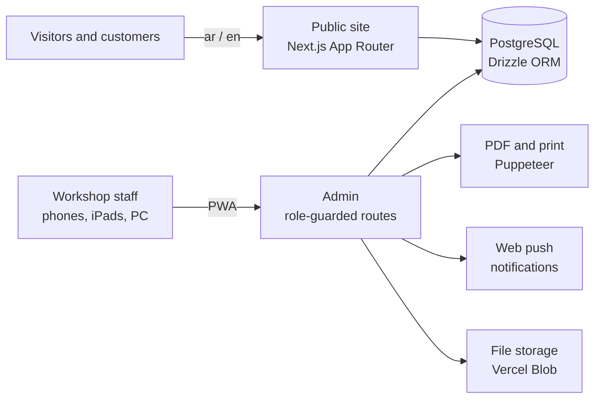

# 🔧 CarHub · كارهب

**The website and the day-to-day operating system of a real car workshop in Al Khobar, Saudi Arabia.**

> 🔒 **The source code is private** because the system holds a business's customer and financial data. This page describes what I built. I'm happy to walk through the code and architecture in an interview.

---

## The problem

The workshop ran on paper job cards, receipt pads and WhatsApp messages. Cards got lost, nobody could see which cars were waiting on parts, and the money was reconciled by hand at the end of the month.

## What I built

One bilingual app that does two jobs.

**1. The public website (Arabic and English, RTL/LTR)**
- A portfolio of restorations and builds that shows visitors real work before they call
- Car and project pages, contact, and a link to the online store
- A private, signed link for each customer to view their own job card

**2. The workshop system, used daily by the team (installable on phones as a PWA)**

| Area | What it does |
|---|---|
| **Job cards** | Takes a car from intake to delivery: repairs grouped by department, parts, VAT, the customer's on-screen signature, and an A4 printout |
| **Inspection reports** | The technician records findings and the customer approves or declines each repair line |
| **Work orders** | A price-free sheet that tells the mechanic exactly what to do |
| **Bay overview** | Card aging, bookings, a trash bin with restore, and oil-change labels |
| **Parts and fitting** | A parts shelf, supplies, purchases, and a fitting board for accessory installs |
| **Money** | Receipt and payment vouchers, payments, deposits with date search, accounts, and printable reports |
| **Roles** | Each role (owner, mechanic, storekeeper, accountant…) sees only its own screens |

## How it's built

`Next.js 16` `React 19` `TypeScript` `Tailwind CSS 4` `PostgreSQL` `Supabase` `Drizzle ORM` `next-intl` `Zod` `Puppeteer` `Web Push` `Vitest` `Vercel`

## Engineering highlights

- **Bilingual from the ground up.** Every screen works in Arabic (RTL) and English (LTR). Customer-facing messages are always in Arabic.
- **Signed customer links.** Customers can open their own card without an account, and the links can't be guessed or enumerated.
- **Tested business logic.** 114 automated tests cover money and payments, stock, bookings, roles and security.
- **Built for the real bay.** Big touch targets for mechanics on phones and iPads, and clean A4 printouts for the counter.
- **Shipped through pull requests.** Every feature goes through a reviewed PR with checks before it reaches production.

---

Built by **Salman Almnaseer** · [Back to profile](https://github.com/EngSalman01) · [Email](mailto:eng.salman01@outlook.com) · [LinkedIn](https://www.linkedin.com/in/salmanrafid/)

